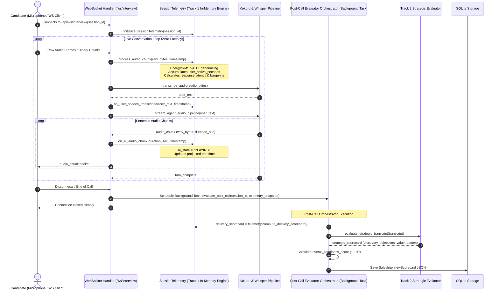

# Implementation Plan: Track 1 Acoustic Telemetry & Unified Sales Interview Scorecard

## Context & Objectives
We are expanding the real-time AI sales interview simulator (FastAPI + WebSockets + Kokoro TTS + Azure Whisper STT) to support **Track 1: Deterministic acoustic & delivery telemetry from raw audio frames and timestamps**, and unifying it with **Track 2: Strategic LLM transcript evaluation** into a consolidated **`SalesInterviewScorecard`**.

Key constraints:
1. **Zero-Latency In Live Loop**: The live WebSocket loop must remain non-blocking and strictly decoupled from heavy analytics and LLM calls. It only tracks in-memory state transitions (VAD events, frame counts, active speech seconds, and timestamps).
2. **Deterministic Delivery Metrics**:
   - **Talk-to-Listen Ratio**: `user_active_seconds / (user_active_seconds + ai_active_seconds)` (benchmarked at 45%–55%, verdicts: `"Balanced"`, `"Pitch Slapping"`, `"Under-engaging"`).
   - **Response Latency (Hesitation)**: `user_speech_start_timestamp - last_ai_playback_end_timestamp` (benchmarked at 0.8s–1.8s, verdicts: `"Crisp"`, `"Hesitant"`, `"Abrupt"`).
   - **Pace / Speaking Rate (WPM)**: `(total_user_words / total_user_active_seconds) * 60` (benchmarked at 130–160 WPM, verdicts: `"Optimal"`, `"Rushing"`, `"Slow"`).
   - **Interruptions & Barge-ins**: Triggered when candidate speaks during `ai_state == "PLAYING"`, filtered to ignore natural backchannels (only count if speech exceeds 3 words or persists for >700ms).
3. **Decoupled Background Orchestration**: An async worker triggered upon disconnection or call conclusion combines Track 1 telemetry with Track 2 transcript evaluation and persists the consolidated scorecard.

---

## Architectural Design



---

## Detailed Specifications

### a) Where `SessionTelemetry` Attaches in the WebSocket Handler
- File: [endpoints.py](file:///home/labuser/Desktop/Project/Elevate/backend/app/api/endpoints.py)
- Inside `_handle_interview_websocket(websocket: WebSocket, session_id: Optional[str] = None)`:
  - At connection initialization: instantiate `telemetry = get_or_create_telemetry(session_id)`.
  - On incoming binary frames (`raw_msg["bytes"]`):
    - Call `telemetry.process_audio_chunk(raw_bytes, timestamp=time.time())`.
  - On incoming text/JSON envelopes (`raw_msg["text"]`):
    - If `msg_type == "audio"`: call `telemetry.process_audio_chunk(audio_bytes, timestamp=time.time())`.
    - If explicit client signals arrive (e.g. `playback_started`, `playback_ended`, `vad_event`), feed into `telemetry.on_client_event(...)`.
  - On transcription completion (`user_text`):
    - Call `telemetry.on_user_speech_transcribed(user_text, timestamp=time.time())` to update word counts and correlate with acoustic active duration.
  - On disconnect / loop termination:
    - In `finally` or `except WebSocketDisconnect`: dispatch background task `run_post_call_evaluation_task(session_id, telemetry)`.

### b) How Playback Timestamps Are Signaled When Kokoro/TTS Streams Audio
- File: [interview_pipeline.py](file:///home/labuser/Desktop/Project/Elevate/backend/app/services/interview_pipeline.py)
  - `synthesize_sentence_to_wav_bytes`: compute exact audio duration: `duration_sec = len(audio_np) / sample_rate` (or from PCM sample count).
  - Include `"duration_sec": duration_sec` in the yielded `audio_chunk` packets.
- File: [endpoints.py](file:///home/labuser/Desktop/Project/Elevate/backend/app/api/endpoints.py)
  - As each `audio_chunk` is streamed to the candidate:
    - Call `telemetry.on_ai_audio_chunk(duration_sec=packet.get("duration_sec", 0.0), timestamp=time.time())`.
  - `telemetry` updates:
    - `ai_state = "PLAYING"`.
    - `last_ai_playback_end_timestamp = max(last_ai_playback_end_timestamp, now) + duration_sec`.
    - `ai_active_seconds += duration_sec`.
  - When candidate speech begins:
    - If `current_time < last_ai_playback_end_timestamp`: mark as potential interruption candidate. Check if candidate speech duration exceeds 0.7s or word count exceeds 3 words. If yes, increment `interruption_count += 1`.
    - If candidate speech begins after AI playback ends (`current_time >= last_ai_playback_end_timestamp`): compute response latency delta: `user_speech_start_timestamp - last_ai_playback_end_timestamp`.

### c) How Post-Call Orchestrator Combines Track 1 & Track 2
- File: [evaluator.py](file:///home/labuser/Desktop/Project/Elevate/backend/app/evaluation/evaluator.py) & [endpoints.py](file:///home/labuser/Desktop/Project/Elevate/backend/app/api/endpoints.py)
  - An asynchronous function `run_post_call_evaluation(session_id: str, telemetry: SessionTelemetry)`:
    1. Extracts `delivery_scorecard` from `telemetry.compute_delivery_scorecard()`.
    2. Retrieves interactions and turn-by-turn analyses from storage.
    3. Executes Track 2 strategic scoring (discovery, objection handling, value proposition, strengths, critical misses, key coaching quote) using candidate analyzer data and LLM rubric prompt.
    4. Calculates `overall_readiness_score` (1-100) combining delivery performance and strategic content.
    5. Formats and persists the exact required schema as `SalesInterviewScorecard`.
    6. Stores in SQLite storage (`evaluations` table and/or dedicated `scorecards` table) and memory cache.
  - An API endpoint `GET /api/session/{session_id}/scorecard` returns the unified scorecard.

---

## Proposed Changes

### Telemetry & Audio Engine (Track 1)

#### [NEW] [telemetry.py](file:///home/labuser/Desktop/Project/Elevate/backend/app/services/telemetry.py)
- Create `SessionTelemetry` class:
  - In-memory tracking of:
    - `session_id: str`
    - `user_active_seconds: float`
    - `ai_active_seconds: float`
    - `total_user_words: int`
    - `response_latencies: List[float]`
    - `ai_state: str` (`"IDLE"` | `"PLAYING"`)
    - `last_ai_playback_end_timestamp: Optional[float]`
    - `interruption_count: int`
  - Zero-latency acoustic VAD:
    - Fast frame RMS / energy detection on audio chunks (16kHz / 24kHz PCM or WAV).
    - Speech onset & hangover debouncing (250ms hangover) to exclude dead silence and prevent fragmented frame bursts.
  - Interruption & barge-in filtering:
    - Correlates candidate speech with `ai_state == "PLAYING"`.
    - Enforces the threshold: only counts as aggressive interruption if speech persists > 700ms or exceeds 3 words (ignoring natural backchannels like "yeah", "ok", "got it").
  - Metric computation & verdict generation:
    - Talk-to-listen ratio: `user_active_seconds / (user_active_seconds + ai_active_seconds)`.
      - `< 0.35`: `"Under-engaging"`
      - `> 0.65`: `"Pitch Slapping"`
      - `0.35` to `0.65`: `"Balanced"`
    - Latency:
      - `< 0.8s`: `"Abrupt"`
      - `0.8s`–`1.8s` (up to 3.0s): `"Crisp"`
      - `> 3.0s`: `"Hesitant"`
    - Pace (WPM): `(total_user_words / total_user_active_seconds) * 60`.
      - `< 115`: `"Slow"`
      - `> 175`: `"Rushing"`
      - `115`–`175`: `"Optimal"`
  - `compute_delivery_scorecard() -> DeliveryScorecard` returning typed pydantic model.
  - Active session registry: `get_session_telemetry(session_id)`, `create_session_telemetry(session_id)`.

#### [MODIFY] [interview_pipeline.py](file:///home/labuser/Desktop/Project/Elevate/backend/app/services/interview_pipeline.py)
- Calculate audio chunk duration in seconds (`duration_sec`) during Kokoro synthesis.
- Expose `duration_sec` in `audio_chunk` packets yielded by `stream_agent_audio_pipeline`.

---

### Evaluation Pipeline & Orchestrator (Track 2 + Merged Scorecard)

#### [NEW] [evaluator.py](file:///home/labuser/Desktop/Project/Elevate/backend/app/evaluation/evaluator.py)
- Define Pydantic models for the consolidated schema:
  - `DeliveryScorecard`
  - `StrategicScorecard`
  - `SalesInterviewScorecard`
- Implement `SalesInterviewEvaluator`:
  - `evaluate_delivery(telemetry: SessionTelemetry) -> DeliveryScorecard`
  - `evaluate_strategic(session_id: str, transcript: List[Dict[str, Any]]) -> StrategicScorecard`
  - `calculate_readiness_score(delivery: DeliveryScorecard, strategic: StrategicScorecard) -> int`
  - `evaluate_post_call(session_id: str, telemetry: SessionTelemetry) -> SalesInterviewScorecard`

#### [MODIFY] [storage_service.py](file:///home/labuser/Desktop/Project/Elevate/backend/app/services/storage_service.py)
- Add `save_scorecard(session_id: str, scorecard: dict)` and `get_scorecard(session_id: str) -> Optional[dict]`.

#### [MODIFY] [endpoints.py](file:///home/labuser/Desktop/Project/Elevate/backend/app/api/endpoints.py)
- Hook `SessionTelemetry` into `_handle_interview_websocket`:
  - Process binary and base64 audio frames.
  - Signal AI audio chunk emission with duration.
  - On WebSocket disconnection or session conclusion, launch background task with `SalesInterviewEvaluator.evaluate_post_call`.
- Expose endpoint:
  - `GET /api/session/{session_id}/scorecard` to retrieve the consolidated scorecard.
  - Update `POST /api/session/{session_id}/conclude` to also include or trigger scorecard generation.

---

### Tests & Verification

#### [NEW] [test_session_telemetry.py](file:///home/labuser/Desktop/Project/Elevate/backend/tests/test_session_telemetry.py)
- Unit tests verifying:
  1. Talk-to-listen ratio calculation and verdicts (`"Balanced"`, `"Pitch Slapping"`, `"Under-engaging"`).
  2. Response latency calculation and verdicts (`"Crisp"`, `"Hesitant"`, `"Abrupt"`).
  3. Pace (WPM) calculation and verdicts (`"Optimal"`, `"Rushing"`, `"Slow"`).
  4. Interruption logic: backchannels ("ok", "yeah", <700ms) are NOT counted; speech >700ms or >3 words IS counted.
  5. Post-call evaluation orchestrator produces the exact consolidated JSON schema.
  6. Non-blocking behavior and WebSocket lifecycle handling.

---

## Verification Plan

### Automated Tests
Run unittest / pytest suite:
```bash
/home/labuser/Desktop/Project/Elevate/venv/bin/python -m unittest backend/tests/test_session_telemetry.py
/home/labuser/Desktop/Project/Elevate/venv/bin/python -m unittest discover -s backend/tests -p "test_*.py"
```

### Manual & Integration Verification
1. Test WebSocket endpoint with synthetic audio chunks and verify real-time frame processing.
2. Verify Kokoro audio streaming yields `duration_sec` and signals `telemetry.on_ai_audio_chunk`.
3. Verify post-call trigger computes `SalesInterviewScorecard` and returns exact JSON schema via `GET /api/session/{session_id}/scorecard`.
