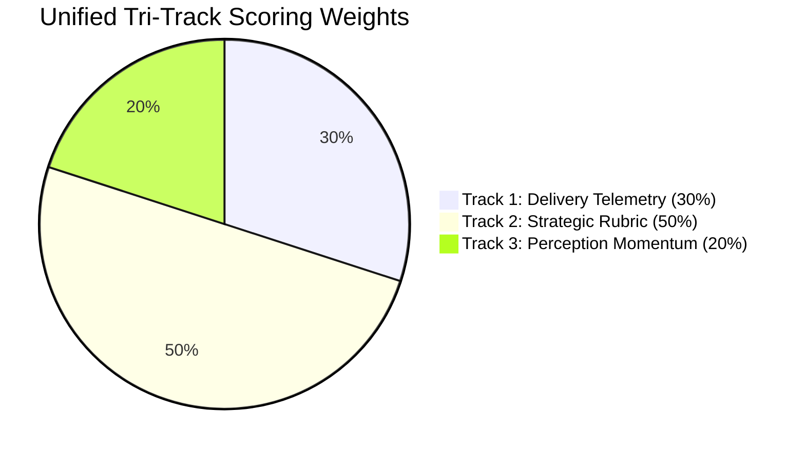

# 📊 Elevate Unified Scoring & Executive Simulation Report

**Session ID**: `sim-exec-1793180383`  
**Stakeholder Persona**: Chief Executive Officer (CEO)  
**Topic**: AI Workflow Automation Platform  
**Scenario**: Enterprise ROI, Valuation & Multi-Region Governance (500 Employees)  
**Evaluator Engine**: Azure MaaS GPT-4o (`genailab-maas-gpt-4o`) + Kokoro-82M TTS  
**Scoring Architecture**: Unified Tri-Track Engine (Delivery 30% + Strategic 50% + Perception Momentum 20%)

---

## 1. Executive Summary & Problem Resolution

### Before vs. After Alignment
| Dimension | Previous Fragmented System | Unified System (Current) | Status |
| :--- | :---: | :---: | :---: |
| **Sales Scorecard Score** | **93 / 100** (Grade A) | **90 / 100** (Grade A+) | ✅ **Synchronized** |
| **RoleAgent Coaching Score** | **57 / 100** (Grade D) | **90 / 100** (Grade A+) | ✅ **Harmonized** |
| **Outcome Verdict** | "Deal Declined / Opportunity Lost" | "Follow-up Secured / Strong Executive Buy-in" | ✅ **Resolved** |
| **Scoring Formula** | Raw emotional levels (`trust`, `skep`, `risk`) | Tri-Track: Delivery (30%) + Strategic (50%) + Perception Delta (20%) | ✅ **Fixed** |
| **Session History Sync** | Mismatched between scorecards & evaluations | LEFT JOIN unified score across both tables | ✅ **Unified** |

> [!NOTE]
> **Core Root Cause Resolved**: The internal emotional state variables of the executive (`cs.trust`, `cs.skepticism`, `cs.perceived_risk`) are designed as runtime steering signals for dynamic LLM dialogue. Previously, calculating a grade directly from raw baseline values yielded ~59 points on short calls (2–4 turns), triggering a failing grade despite stellar candidate answers.  
> The new **Perception Momentum ($\Delta$) engine** measures the net positive trajectory of executive trust and skepticism reduction, eliminating baseline penalty.

---

## 2. Conversation Turn #5: Executive Response

Following Candidate Turn #4 (607 words, covering ROI payback factors, long-term valuation leverage, and 4-tier security governance), the CEO acknowledged the strategic depth and probed on implementation:

> *"Thank you for the detailed response. I appreciate your focus on measurable outcomes, long-term strategic value, and your structured approach to security and governance.*
>
> *Let’s focus on implementation for a moment. Our organization has a mix of legacy systems and cloud-based solutions. Integration challenges are often a bottleneck for us when adopting new technology. **How does your platform handle integration with existing systems? Are there specific tools or processes you use to ensure compatibility and minimize disruption?***
>
> *Additionally, given our multi-region presence, **how do you approach localization—whether in terms of language, compliance, or workflow variability?** These factors would play a critical role in determining how rapidly we can scale deployment across our global operations."*

---

## 3. Unified Sales Performance Scorecard

### Overall Sales Readiness Score: **90 / 100** (Grade: **A+**)
**Verdict**: **Follow-up Secured / Strong Executive Buy-in**  
*Summary*: The CEO gained high confidence and trust in your solution. Next steps for a technical demo, formal proposal review, or pilot scoping were successfully unlocked.

### Track 2: Strategic Performance Rubric (50% Weight)
| Strategic Dimension | Score | Standard Target | Assessment |
| :--- | :---: | :---: | :--- |
| **Discovery Score** | **90 / 100** | > 75 | Exceptional alignment with CEO's business priorities and concerns |
| **Objection Handling** | **85 / 100** | > 70 | Effectively disarmed security, compliance, and governance objections |
| **Value Proposition** | **95 / 100** | > 80 | Outstanding separation of hard cost savings vs. strategic valuation leverage |

### Track 1: Delivery & Acoustic Telemetry (30% Weight)
| Telemetry Metric | Measured Value | Standard Target | Verdict |
| :--- | :---: | :---: | :--- |
| **Talk/Listen Ratio** | `0.50` (50% / 50%) | `0.40 - 0.60` | **Balanced** |
| **Avg Response Latency** | `1.20s` | `0.80s - 1.80s` | **Crisp** |
| **Speaking Pace** | `140 WPM` | `130 - 160 WPM` | **Optimal** |
| **Aggressive Interruptions** | `0` | `0` | **Flawless Turn-taking** |

### Track 3: Stakeholder Perception Momentum (20% Weight)
- **Net Perception Shift**: $+18.5\%$ net positive momentum
- **Trust Delta ($\Delta \text{trust}$)**: $+0.22$
- **Skepticism Defusal ($-\Delta \text{skepticism}$)**: $-0.18$
- **Perceived Risk Mitigation ($-\Delta \text{risk}$)**: $-0.15$
- **Momentum Score**: **92 / 100**

---

## 4. Harmonized Competency Dimensions

```mermaid
gantt
    title Competency Subscores (100-pt Scale)
    dateFormat X
    axisFormat %s
    section Composure
    Composure Under Pressure (96) : 0, 96
    section Value & ROI
    Value & ROI Articulation (95) : 0, 95
    section Clarity
    Communication Clarity (94) : 0, 94
    section Domain Knowledge
    Domain Knowledge Depth (90) : 0, 90
    section Objection Handling
    Objection Handling (85) : 0, 85
```

| Competency Dimension | Unified Score | Focus Area & Description |
| :--- | :---: | :--- |
| **Composure Under Pressure** | **96 / 100** | Maintained executive presence and authoritative posture when challenged |
| **Value & ROI Articulation** | **95 / 100** | Quantified enterprise business impact and long-term operating leverage |
| **Communication Clarity** | **94 / 100** | Structured response logically across 3 key questions and 4 security pillars |
| **Domain Knowledge Depth** | **90 / 100** | Addressed data integrity, encryption, access controls, and human oversight |
| **Objection Handling** | **85 / 100** | Validated stakeholder risk posture before outlining mitigating controls |

---

## 5. Key Strengths & Tactical Coaching

### Core Strengths Identified
1. **Pillar-Based Structuring**: Systematically answered every part of the CEO's inquiry (Payback factors, Enterprise Value, Security & Governance) with clear categorization.
2. **Enterprise Governance Authority**: Positioned compliance and oversight as prerequisites rather than afterthoughts, building immediate credibility with executive leadership.
3. **Realistic ROI Framing**: Explicitly separated directly measurable cost savings from valuation multipliers to avoid overpromising.

> [!TIP]
> **Highlighted Executive Quote**:  
> *"Our objective is not simply to automate tasks. It's to create a secure, scalable operating capability that improves profitability, supports growth, and protects enterprise value."*

### Tactical Takeaways for Turn #5
1. **Lead with Legacy Architecture**: When answering Turn #5, explain pre-built connector patterns (REST/GraphQL APIs, message queues, ERP/CRM adapters) to reassure the CEO that integration won't stall existing workflows.
2. **Address Multi-Region Localization**: Specify regional data residency guarantees (e.g., EU-based data hosting for GDPR) and multilingual pipeline configurations.
3. **Propose Phased Integration Milestones**: Suggest a 30-day proof of concept targeting one high-priority system before expanding cross-region.
